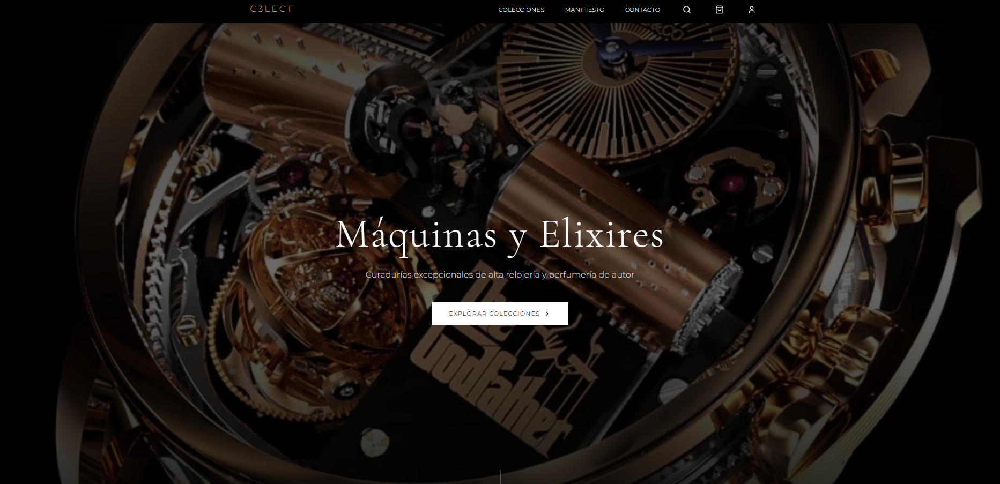
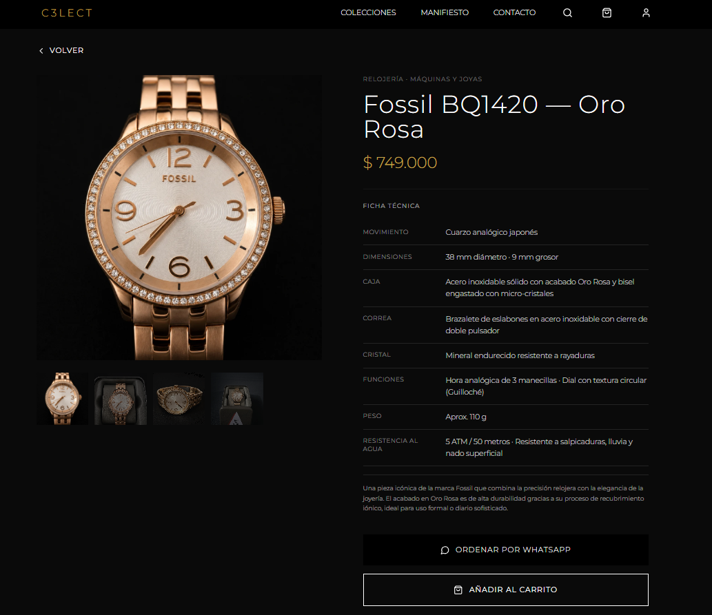
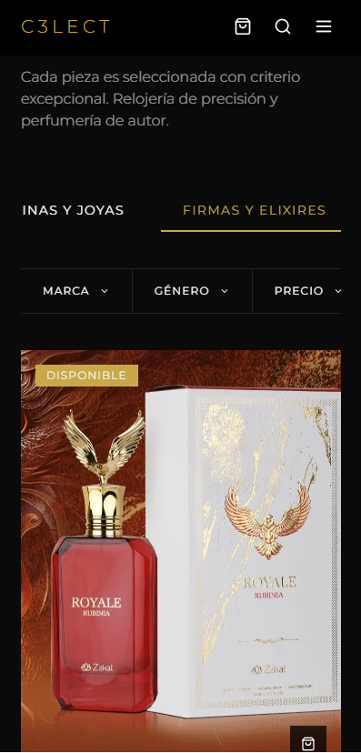

# Bóveda C3LECT

Catálogo digital de relojería y perfumería de alta gama. Es la tienda en línea de **C3LECT** — Medellín, Colombia.

🔗 **[Ver en vivo](https://c3lect.com/)** · 🔐 **[API que la alimenta](https://github.com/cetremore26/c3lect-api)** (su documentación Swagger solo se expone fuera de producción)



<table>
<tr>
<td width="65%"></td>
<td width="35%"></td>
</tr>
</table>

---

## El problema

C3LECT vendía por WhatsApp: fotos sueltas, precios repetidos a mano en cada conversación, disponibilidad que solo existía en la cabeza del vendedor. Cada cliente nuevo obligaba a rearmar el catálogo desde cero, y no había forma de mostrar una marca premium enviando imágenes desordenadas por chat.

## La solución

Un catálogo web propio, sobrio y siempre actualizado. El cliente navega por su cuenta, filtra por lo que le interesa, ve stock real y llega a la conversación de venta ya decidido. El inventario se administra en un solo lugar y se refleja al instante en la tienda.

El catálogo se divide en dos líneas: **Máquinas y Joyas** (relojería) y **Firmas y Elixires** (perfumería).

---

## Funcionalidades

- Catálogo con filtros por categoría, marca, género y rango de precio
- Ficha de producto con especificaciones técnicas completas de relojería (movimiento, caja, correa, cristal, resistencia al agua, reserva de marcha) y pirámide olfativa para perfumería (notas de salida, corazón y fondo)
- Stock en vivo desde la base de datos — el carrito no permite pedir más de lo disponible
- Checkout para invitados y para usuarios registrados
- Pago en línea vía MercadoPago
- **Reseñas de productos:** la lectura es pública, desde la vista `resenas_publicas` de Supabase; escribirlas y moderarlas pasa por la API
- **Cuenta del cliente** (`/cuenta`): perfil, direcciones y "Mis pedidos"
- **Registro con código:** email → código de 6 dígitos por correo → formulario de cuenta; nadie crea una cuenta sin verificar su correo
- **2FA del admin:** tras la contraseña, el admin ingresa el código enviado a su correo
- **Recuperación de contraseña:** el enlace del correo lleva el token en el fragmento (`#token=…`), con pantalla de nueva contraseña; en esa ruta no se carga el Pixel de Meta
- **Panel admin** (`/admin`): productos (con orden de destacados), pedidos, clientes, ventas, compras, gastos, inventario, precios, promociones, reseñas, auditoría y panel de métricas con gráficas (Recharts)
- Interfaz responsive con animaciones de Motion

---

## Stack

| Capa | Tecnología |
|---|---|
| Framework | React 18 + TypeScript |
| Build | Vite 6 |
| Estilos | Tailwind CSS 4 |
| Enrutamiento | React Router 7 |
| Animaciones | Motion (Framer Motion) |
| Gráficas | Recharts |
| Iconos | Lucide React |
| HTTP | Axios |
| Datos | Supabase + [C3LECT API](https://github.com/cetremore26/c3lect-api) |
| Deploy | Cloudflare Pages |

---

## Arquitectura

```
Bóveda (React SPA · Cloudflare Pages · c3lect.com)
      │
      ├── Supabase ──────────► catálogo público (vista catalogo_publico: productos, stock y precio)
      │
      └── C3LECT API ────────► login · cuenta · pedidos · pagos · panel admin
              │
              ├── PostgreSQL en Supabase (Prisma)
              ├── MercadoPago
              └── Resend (correos)
```

La tienda lee el catálogo directo de la vista `catalogo_publico` de Supabase, así no depende de que la API esté despierta. El rol público (`anon`) solo puede leer esa vista, nunca las tablas.

Todo lo demás pasa por `src/app/api/`: un archivo por módulo del backend, y el único lugar que habla con la API. `scripts/check-architecture.mjs` (corre en `pnpm typecheck`) hace cumplir esa regla.

**Carrito y checkout.** El carrito guarda solo `{ id, cantidad }`; el stock, el precio y la disponibilidad se resuelven siempre contra el catálogo. El checkout no vacía el carrito antes de redirigir a MercadoPago: guarda un `pendingCheckout` y el carrito se vacía en `/checkout/success`, cuando el pago se aprobó. Un pago rechazado o abandonado no pierde el carrito.

---

## Puesta en marcha

```bash
pnpm install
cp .env.example .env    # completa las credenciales
pnpm dev                # http://localhost:5173
pnpm build               # build de producción
pnpm test                # Vitest
pnpm lint                # ESLint
pnpm typecheck           # tsc + reglas de arquitectura (scripts/check-architecture.mjs)
```

### Variables de entorno

| Variable | Para qué |
|---|---|
| `VITE_SUPABASE_URL` | URL del proyecto Supabase |
| `VITE_SUPABASE_ANON_KEY` | Clave pública de Supabase |
| `VITE_API_URL` | URL base de la C3LECT API |
| `VITE_META_PIXEL_ID` | ID del píxel de Meta (opcional) |

---

## Despliegue

| Pieza | Dónde | Cómo |
|---|---|---|
| Frontend | Cloudflare Pages · [c3lect.com](https://c3lect.com/) | Cada push a `main` se compila con pnpm y se publica solo |
| API | Render | Cada push a `main` del repo de la API se publica solo |
| Base de datos | Supabase (PostgreSQL) | Migraciones con Prisma desde el repo de la API |

**Orden de despliegue: primero el frontend, luego la API.** El front nuevo es compatible con la API vieja, pero la API nueva no lo es con el front viejo (por ejemplo, exige `registrationToken` para registrar y responde `requiresSecondFactor` al admin). Los pasos completos de la API están en su README.

Las cabeceras de seguridad (CSP, X-Frame-Options…) están en `public/_headers` y las reglas de la SPA en `public/_redirects`.

---

## Licencia

MIT — ver [LICENSE](LICENSE).

Desarrollado por **Manuel Sebastián Cetre** · [GitHub](https://github.com/cetremore26) · cetremore@gmail.com
